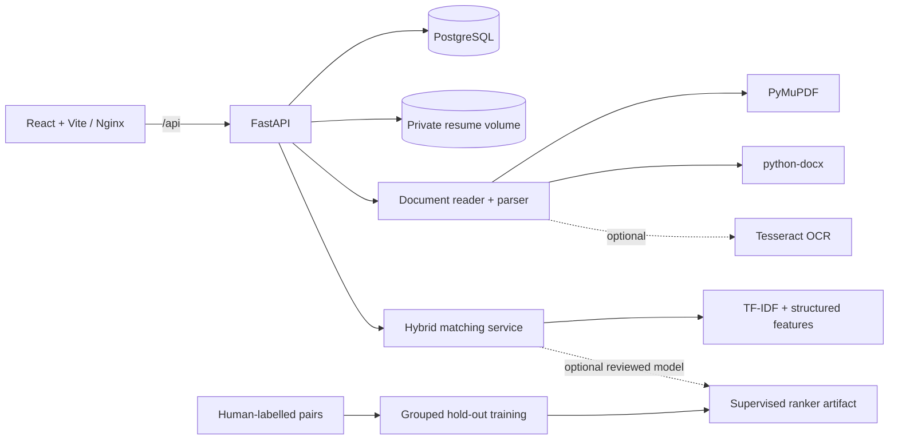

# ResumeIQ architecture

## Runtime topology

## Backend modules

- `app/api`: HTTP routes and request validation.
- `app/core`: environment settings, password hashing, token signing and authorization dependencies.
- `app/db`: SQLAlchemy engine/session and schema initialization.
- `app/models`: relational entities and JSON structured profile fields.
- `app/schemas`: Pydantic request DTOs and validation.
- `app/services/document_reader.py`: file validation, PDF/DOCX text extraction and optional OCR.
- `app/services/parser.py`: section recognition, canonical skill taxonomy, date normalization, structured extraction and source evidence.
- `app/services/matcher.py`: explainable matching baseline and optional supervised-ranker hook.
- `app/services/ranking_features.py`: shared candidate/job pair features for training and inference.
- `app/services/serializers.py`: response shape mapping.

## Data model

- `Candidate` stores the structured candidate profile and parser-quality metadata.
- `ResumeDocument` stores document metadata, checksum, parser version, extracted text, warnings and parsed payload. Binary files live outside the database in a private volume.
- `Job` stores the role brief, responsibilities, requirements and status.
- `Application` connects a candidate to a job and tracks stage, source and notes. A unique candidate/job constraint prevents duplicate applications.
- `MatchResult` stores an explainable role-match result and component scores.
- `Interview` stores schedule, participants, notes, status and scorecard JSON.
- `ActivityEvent` stores workflow events for an operational timeline.
- `User` stores workspace credentials, role and active status.

## Parser data flow

1. Check extension, file signature, size and archive structure.
2. Extract PDF page text in reading order or DOCX paragraphs/tables/hyperlinks.
3. For scanned PDFs, either return a clear OCR-disabled warning/error or perform bounded optional OCR.
4. Identify headings and section boundaries.
5. Extract identity, skills, experience, education, projects and additional profile sections.
6. Normalize month/year values and calculate non-overlapping experience duration where the date evidence supports it.
7. Attach source snippets, line/page references and per-field confidence where available.
8. Estimate extraction completeness and create review warnings.
9. Persist candidate, document metadata, extracted text and private file in a single database transaction (with file cleanup on failure).
10. Let a recruiter inspect and correct the structured profile.

## Matching data flow

The default score combines:

- Required/preferred skill coverage.
- TF-IDF text similarity between job-related profile content and the role brief.
- Experience-range fit.
- Education-context fit.

Candidate names and employer identities are excluded from the matching text. Missing experience/education data is treated as uncertain rather than as proof of a negative attribute. The output includes matched skills, missing required skills, component signals and plain-language explanations. It is not a probability of job performance.

## Training/inference contract

`training/train_ranker.py` and `app/services/trained_ranker.py` use the same `ranking_features.pair_matrix` representation. A reviewed CSV is split by candidate ID so one candidate never appears in both train and hold-out. A model is saved as a candidate artifact and is not enabled automatically. Review model metrics and the data before enabling it.

## Frontend structure

`App.jsx` contains the workspace shell and focused feature views: Overview, Candidates, Roles, Applications, Interviews, Intelligence, Analytics and Settings. `api.js` centralizes JSON requests and authenticated document downloads. `styles.css` owns the Oxblood Chrome design system.

The frontend refreshes current workspace totals periodically while visible. Vite proxies `/api` to the local FastAPI port. In Docker, Nginx proxies `/api` to the backend service.

## Operational assumptions

- Local Compose uses PostgreSQL 16 and persistent named volumes.
- Resume binaries are not stored as public/static web assets.
- Development defaults to authentication disabled; enable auth and configure secrets before shared use.
- The initial database migration creates the baseline schema. Future shared database changes require new migrations.
